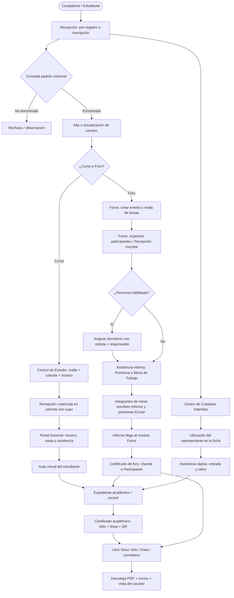
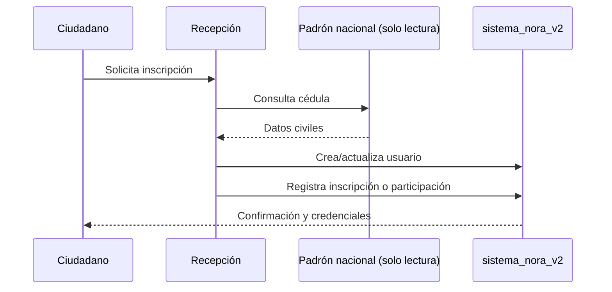
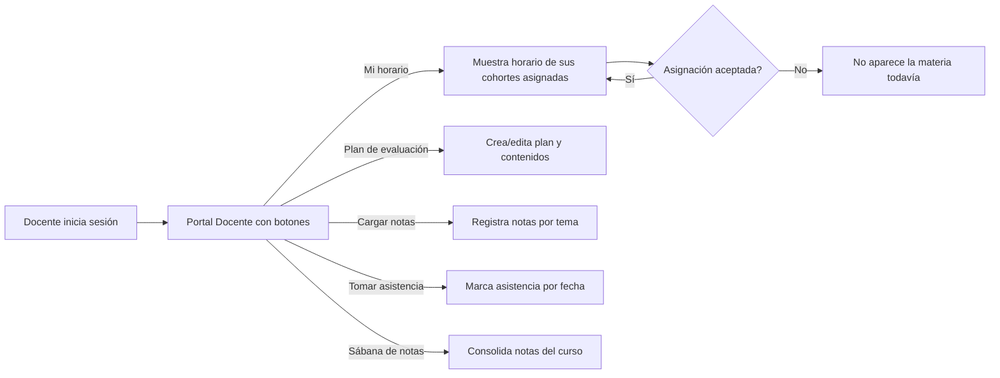
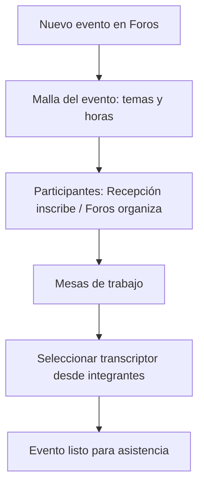
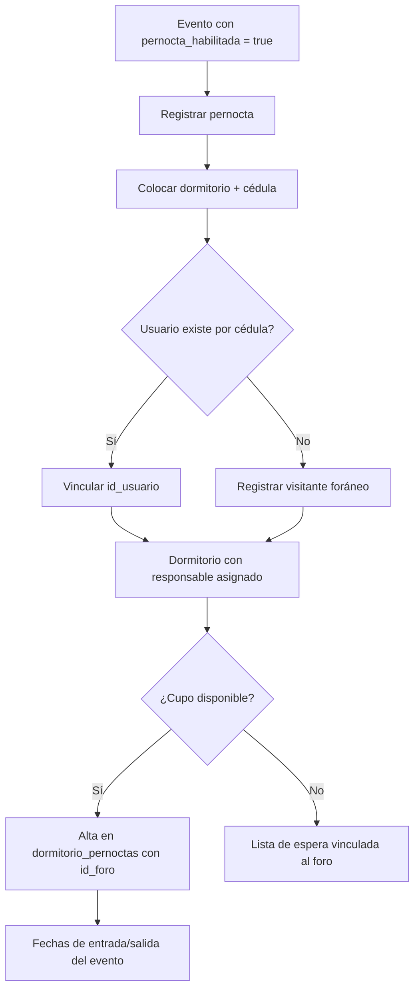
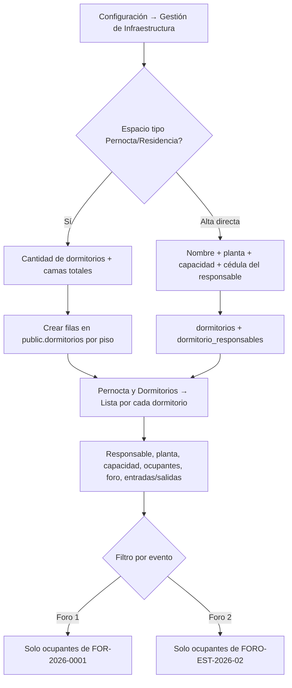
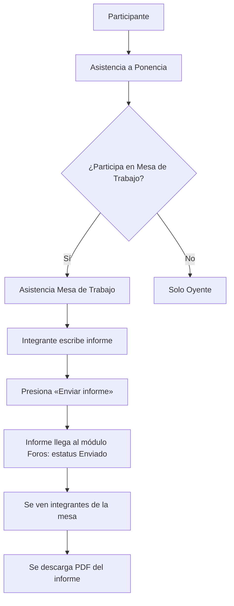
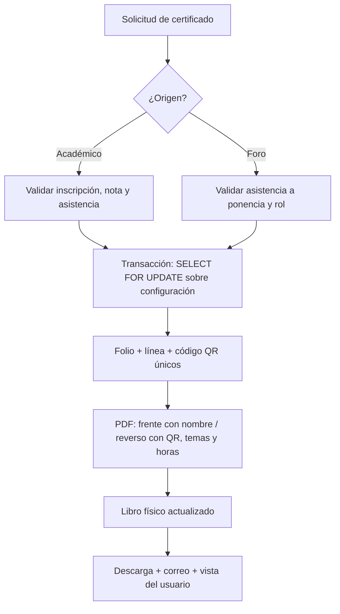
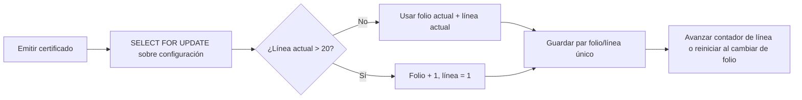
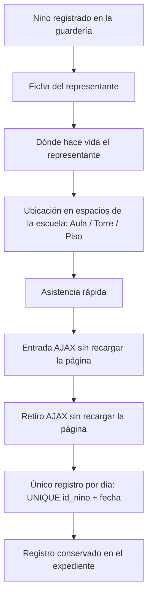

# Flujograma de procesos — Sistema Nora

Documento de referencia del flujo paso a paso de los procesos del sistema después de la reorganización de módulos.

## 0. Mapa de módulos (dónde se hace cada cosa)

| Proceso | Módulo responsable | Observación |
|---|---|---|
| Pre-registro / inscripción / matrícula | **Recepción** (`modulos/recepcion/`) | Única entrada de inscripción. |
| Mallas, cursos, cohortes, horarios, notas, carga masiva, certificados académicos, expedientes | **Control de Estudio** (`modulos/control_estudio/`) | Ya no contiene el checklist de Foros/C conversatorios/Seminarios. |
| Foros, Conversatorios y Seminarios (creación, malla, participantes, asistencia, mesas, informes, certificados de foro) | **Foros** (`modulos/foros/`) | `participantes.php` es consulta/organización; no inscribe. |
| Aula virtual, expediente propio, constancias, mis foros, mi informe | **Estudiante** (`modulos/estudiante/`, `modulos/foros/mis_foros.php`) | Todo queda guardado en el record académico. |
| Horario, notas, asistencia, plan de evaluación | **Profesor** (`modulos/profesor/`) | El horario se muestra al presionar su botón. |
| Pernocta y dormitorios | **Recepción / Foros** | Vinculada al evento extraordinario (`foros_eventos.pernocta_habilitada`). |
| Guardería (Centro de Cuidados Infantiles) | **Guardería** (`modulos/guarderia/`) | Incluye “dónde hace vida el representante” y asistencia rápida. |

---

## 1. Flujo general

---

## 2. Inscripción y pre-registro (Recepción)

| Paso | Actor | Acción | Validación / regla | Resultado |
|---|---|---|---|---|
| 1 | Ciudadano | Solicita inscripción o pre-registro | — | Solicitud iniciada |
| 2 | Recepción | Busca la cédula en el padrón nacional | Base `padron_nacional_db` es **solo consulta**; no se borra ni se modifica | Datos civiles confirmados |
| 3 | Recepción | Verifica si el usuario ya existe en `sistema_nora_v2` | Evita duplicados por cédula | Alta o reutilización de `usuarios` |
| 4 | Recepción | Completa ficha (contacto, dirección, datos complementarios) | Todo POST lleva `_csrf` | Usuario activo |
| 5 | Recepción | Selecciona curso o foro | El foro debe existir en `foros_eventos` | Inscripción dirigida |
| 6 | Sistema | Registra la inscripción | cupo disponible / no duplicado | `inscripciones` o `foro_participantes` |
| 7 | Sistema | Guarda rastro en el expediente | “Todo lo que haga un estudiante se guarda porque es parte de su record académico” | Trazabilidad |

---

## 3. Matrícula y carga académica (Control de Estudio + Recepción)

| Paso | Actor | Acción | Validación | Resultado |
|---|---|---|---|---|
| 1 | Control de Estudio | Crea malla (`mallas_curriculares`) | Tipo de oferta definido | Malla disponible |
| 2 | Control de Estudio | Crea módulo (`malla_materias`) | Horas del módulo = suma de temas | Módulo coherente |
| 3 | Control de Estudio | Crea temas (`materia_contenidos`) | Horas por tema > 0 | Contenido programado |
| 4 | Control de Estudio | Crea cohorte (`cohortes`) | `cupos_maximos` definido | Sección con cupo |
| 5 | Control de Estudio | Asigna docente (`asignaciones_profesor`) | `estatus_aceptacion='Aceptado'` | Docente ve su materia |
| 6 | Control de Estudio | Carga horario (`horarios_secciones`) | Trigger `validar_carga_docente()`: disponibilidad, carga máxima y **sin choques** | Horario válido |
| 7 | Control de Estudio | Crea plan de evaluación y lo liga a los temas | `plan_evaluacion_contenidos` | Evaluación lista |
| 8 | Recepción | Matricula al estudiante | Cupo no superado; sin matrícula repetida | `inscripciones` + nota inicial opcional |
| 9 | Sistema | Genera asistencia de clases | Única por `(cohorte, estudiante, fecha)` | `asistencia_clases` |

**Regla de horas:** “1 módulo y 4 temas” se modela como 1 fila en `malla_materias` + 4 filas en `materia_contenidos`. Ejemplo verificado: Emprendimiento = 4 temas × 30 h = **120 h exactas** (límite ≤ 120).

### 3.1 Descarga del padrón de matrícula (XLS)

| Paso | Acción | Detalle |
|---|---|---|
| 1 | Filtrar en `matricula_general.php` | Cédula/nombre (`q`), carrera (`id_malla`) y sección (`id_cohorte`) |
| 2 | Presionar **Descargar XLS** | El botón conserva los filtros activos en la URL |
| 3 | `exportar_matricula_xls.php` | Aplica la misma consulta y agrupación por estudiante + malla |
| 4 | Cálculo de avance | `academico_estado_malla()` por cada estudiante/carrera |
| 5 | Archivo | `Padron_Matricula_AAAAAMMDD_HHMMSS.xlsx`, generado con `includes/xlsx.php` |

**Validado:** 103 estudiantes exportados, 107 filas leídas de vuelta con `xlsx_leer_filas()` (membrete, filtros, encabezados y datos).

### 3.2 Catálogo académico (todos los módulos)

Ruta: `modulos/control_estudio/catalogo_modulos.php`.

- Muestra **todas** las mallas/carreras, sus módulos/asignaturas, temas y horas, aunque no estén asignadas a un docente.
- Filtros: texto libre por carrera, módulo o tema (`q`) y carrera específica (`id_malla`).
- Totales en pantalla: carreras, módulos/asignaturas y temas visibles.
- Advertencia cuando la suma de horas de los temas no coincide con las horas declaradas del módulo.
- Acceso: entrada directa en `includes/header.php` para **todos los roles** y también dentro de **Control de Estudio → Diseñar Malla Curricular**.
- Acceso directo adicional: botón **Catálogo de módulos** en el Portal Docente (`modulos/profesor/index.php`).

**Validado:** página renderizada sin errores como `superadmin`, `profesor` y `estudiante` con `q=Emprendimiento` (33 KB / 24 KB / 22 KB respectivamente, `errores=[]`).

---

## 4. Portal Docente (botones y horario)

| Paso | Validación |
|---|---|
| Ingreso | Role `profesor`, `admin`, `superadmin` o `control_estudio`. |
| Propiedad | `asignaciones_profesor` con `estatus_aceptacion='Aceptado'`; `id_cohorte=NULL` aplica a todas las secciones de la malla. |
| Horario | Se despliega **solo cuando el docente presiona su botón “Mi horario”**. |
| Notas | Solo materias propias y planes de su cohorte. |
| Asistencia | Una sola marca por estudiante y fecha. |
| Catálogo | Botón **Catálogo de módulos** → consulta de toda la malla académica, no solo las asignaturas propias. |

---

## 5. Asistencia de clases y record académico

1. El docente presiona **Tomar asistencia**.
2. Selecciona cohorte y fecha.
3. Marca `Presente` / `Ausente` / `Justificado`.
4. El trigger/índice evita duplicar `(id_cohorte, id_estudiante, fecha_clase)`.
5. La asistencia se refleja en:
   - Aula virtual del estudiante.
   - Expediente académico.
   - Elegibilidad para certificado.

> Todo registro de estudiante (nota, asistencia, foro, informe, pernocta, guardería y certificado) queda conservado como parte de su record académico.

---

## 6. Foros, Conversatorios y Seminarios

### 6.1 Creación del evento (módulo Foros)

| Paso | Acción | Regla |
|---|---|---|
| 1 | Nuevo evento en `modulos/foros/` | Tipos: Foro, Conversatorio, Seminario |
| 2 | **Primero** se crea la malla del evento (`foro_temas`) | Horas del evento = suma de horas de temas |
| 3 | **Después** se organizan los participantes | Recepción hace la inscripción; `participantes.php` solo consulta/organiza |
| 4 | Se crean mesas (`foro_mesas`) | Se crean **sin transcriptor** |
| 5 | Desde la lista de integrantes de la mesa se habilita el transcriptor | `id_transcriptor` se actualiza allí |

### 6.2 Pernocta

> Regla del usuario: **“para llenar solo se coloca el dormitorio y el número de cédula”**. Cada dormitorio tiene responsable; puede haber varias dormitorios por planta física; la pernocta está **obligatoriamente vinculada al evento extraordinario**.

Validaciones verificadas en la prueba de estrés: ocupación por dormitorio ≤ capacidad, responsable presente en todos los dormitorios, 6 dormitorios (3 por planta), 60 pernoctas vinculadas a los 2 foros con fechas sin traslape.

#### 6.2.1 Dormitorios desde Gestión de Infraestructura y lista por dormitorio

> Los dormitorios reales de pernocta (`public.dormitorios`) ahora se crean también desde **Gestión de Infraestructura**. La infraestructura física genérica (`campus_espacios`) sigue siendo la ficha del espacio; al guardar un espacio de tipo **Pernocta / Residencia Estudiantil** se generan las habitaciones reales con su capacidad. Además existe un formulario directo “Registrar Dormitorio” con planta, camas y responsable por cédula.

> Un mismo dormitorio puede reutilizarse en varios foros en fechas distintas. Por eso la **lista por cada dormitorio** muestra el evento de cada ocupante y permite filtrar por foro; el conteo de camas es por evento, no acumulado entre foros.

### 6.3 Asistencia interna e informes

**Rol de certificado:** Ponencia = `Oyente`; Ponencia + Mesa de Trabajo (o informe `Enviado`) = `Participante`. Sin asistencia a Ponencia **no se puede emitir certificado** (validación confirmada en pruebas negativas).

---

## 7. Certificados

### 7.1 Académico (Control de Estudio)

| Paso | Acción | Detalle |
|---|---|---|
| 1 | Verificar elegibilidad | Asistencia + nota/aprobación de la inscripción |
| 2 | Emitir | `certificado_obtener()` dentro de transacción |
| 3 | Reservar folio y línea | `certificado_asignar_folio()` usa `SELECT ... FOR UPDATE`; evita duplicados concurrentes |
| 4 | Libro físico | Un folio admite **20 líneas** (configurable 1–100): folio 1 líneas `1..20`, folio 2 líneas `1..20`, etc. Al agotarse, se abre el folio siguiente y la línea vuelve a 1 |
| 5 | Integridad | `UNIQUE (folio, linea_libro)`; el folio ya no es único por sí solo |
| 6 | Frente | Nombre del participante |
| 7 | Reverso | Código QR, temas y horas |
| 8 | Entrega | Descarga PDF, envío por correo y vista en el portal del usuario |

### 7.2 Foro (módulo Foros)

- Usa `origen='Foro'`, `id_foro` e `id_malla/id_inscripcion = NULL`.
- Igualdad de reglas:folio/línea/QR/temas/horas del evento.
- El listado de Control de Estudio incluye ambos orígenes mediante `LEFT JOIN` + `COALESCE(m.nombre_programa, fe.nombre)`.

### 7.3 Folios con varias líneas

- Configurable en **Control de Estudio → Certificados**, campo **Líneas por folio** (1–100, defecto 20), persistido en `certificado_configuracion.lineas_por_folio` (migración `008_certificados_folios_lineas.sql`).
- Migración aplicada sobre 166 certificados: 9 folios (`CERT-2026-00001` … `00009`), líneas `1..20`; el último folio quedó con líneas `1..6`; contadores `folio_actual=9`, `linea_actual=7`.
- Se eliminó `UNIQUE(folio)` y se creó `UNIQUE(folio, linea_libro)`.
- El Excel de folios y líneas (`certificados.php?action=excel`) refleja el folio y la línea de cada certificado.

**Validado:** 10 emisiones concurrentes con cambio de folio, 10 códigos y 10 pares `(folio, línea)` únicos, 0 errores.

### 7.4 Descarga masiva filtrada por curso

Ruta: `modulos/control_estudio/certificados_masivos.php`. El card **Descarga masiva de certificados por curso** quedó en `certificados.php#descarga-masiva`.

| Filtro | Uso |
|---|---|
| `id_malla` | Curso/carrera completa |
| `id_cohorte` | Una sección específica (el sistema valida que pertenezca a `id_malla`) |
| `modo=completados` | Genera/recupera certificados de quienes completaron la malla del curso filtrado |
| `modo=emitidos` | Descarga solo certificados ya emitidos (`origen='Academico'`, `tipo='Culminacion'`, `estado <> 'Anulado'`) del curso filtrado |

- Un solo PDF con todos los seleccionados; límite de seguridad de **300 certificados por archivo**.
- El nombre del archivo incluye el curso o la sección: `Certificados_<curso|seccion>_AAAAAMMDD_HHMMSS.pdf`.
- Si los filtros se contradicen (por ejemplo, carrera 11 con sección de la carrera 10), la página responde **Filtros incompatibles** y no genera nada.

**Validado:** con filtro `id_malla=10` y con `id_cohorte=11`, ambos modos devolvieron exactamente 20 certificados de la única sección `EST-2026-C1` (folios `CERT-2026-00001:7..20` y `CERT-2026-00002:1..6`); 40 páginas PDF por archivo, sin avisos PHP. El caso incompatible fue rechazado.

---

## 8. Centro de Cuidados Infantiles (Guardería)

- Nombre de interfaz, PDF y mensajes: **Centro de Cuidados Infantiles**.
- Implementación: `includes/representante_ubicacion.php`, `modulos/guarderia/api_marcar.php`, migración `007_guarderia_asistencia.sql`.
- Ejemplo de ubicación mostrada: `Aula 101 · Torre Norte · Piso 1`.

---

## 9. Puntos de control de la prueba de estrés

| Prueba | Resultado |
|---|---|
| Siembra de 5 cursos, 5 profesores, 100 estudiantes, 2 foros, 60 pernoctas | 1.85 s, transacción única |
| Verificación de integridad (`verificar_estres.php`) | Todas las verificaciones pasaron |
| 20 pantallas clave en lotes de 5 (incluye dormitorios, infraestructura, informes y asistencia docente) | Máx. 1.36 s / 6 MB |
| 11 portales (estudiante, docente, foros, guardería) | Sin errores |
| 12 usuarios de prueba, uno por rol, clave única `123456` | 12/12 portales y menús segmentados correctamente |
| 10 emisiones concurrentes de folios | 10 folios, 10 líneas y 10 códigos distintos |
| 10 PDFs (5 académicos + 5 de foro) | 18.75 s, pico 58 MB |
| Plan de evaluación docente (`id_cohorte=11`, `id_materia=13`) | 33.452 bytes HTML, `errores=[]` |
| Descarga masiva filtrada (carrera 10 / sección 11, modos completados y emitidos) | 20 certificados de `EST-2026-C1`, 40 páginas PDF por archivo, 0 avisos |
| Catálogo académico como superadmin, profesor y estudiante | 3/3 sin errores |
| Pruebas negativas (choque de horario, asistencia duplicada, certificado sin ponencia, cupo, doble marcaje, filtros incompatibles de certificados) | Todas rechazadas correctamente |

### Fallas detectadas y corregidas

1. `modulos/foros/index.php`: `Undefined array key "horas_temas"` → se agregó `COALESCE(SUM(t.horas_academicas), 0)` desde `foro_temas`.
2. `modulos/foros/mis_foros.php`: mismo error en el portal del estudiante → se agregó la misma columna calculada.
3. `modulos/control_estudio/certificados.php`: `INNER JOIN` ocultaba los certificados de foro → se cambió a `LEFT JOIN` + `COALESCE(m.nombre_programa, fe.nombre)`.
4. Portal Docente: los profesores nuevos no veían materias → se agregaron 5 `asignaciones_profesor` aceptadas y se actualizó el seed.
5. Error de siembra: `dormitorios.id_responsable` recibía una cédula en vez de `id_usuario` → se resuelve el `id_usuario` del monitor por cédula.
6. Scripts de prueba en Windows: `escapeshellarg()` destruye JSON con comillas → se pasan argumentos en base64.
7. Script de concurrencia inicial: los `ROLLBACK` hacían reaparecer los mismos folios → se cambió a emisiones confirmadas con limpieza y restauración de contadores.
8. `includes/contenidos_evaluacion.php`: al sincronizar temas de la malla se violaba `materia_contenidos_orden_uq` y el plan de evaluación quedaba en blanco → ahora se omiten temas existentes por descripción, se usa el siguiente `orden` libre y se ignoran las líneas sin horas declaradas (no son temas reales); además, cualquier fallo de sincronización es auxiliar y ya no bloquea la página.
9. Descarga masiva sin filtro → ahora permite elegir curso, sección y modo, con validación de compatibilidad y límite de 300.

---

## 9.1 Buscadores y usuarios por rol

### Buscadores por nombre o cédula

Se agregó el componente reutilizable `includes/buscador_lista.php`. Filtra en el navegador por **nombre, apellido o cédula** (acepta `V-12345678` y `12345678`) sin recargar la página y **sin alterar los `id` reales** que envían los formularios (`id_participante`, `id_nino`, etc.).

Listas donde quedó instalado:

- Foros: asistencias, participantes, mesas/integrantes, certificados e informes.
- Control de Estudio: certificados (emitidos y listos para certificar).
- Recepción: panel del día (visitas y alertas QR).
- Cuidados Infantiles: matrícula infantil y asistencia rápida.
- Pernocta: dormitorios, lista por dormitorio y pernoctas activas.
- Portal Docente: asistencia de clases.

Ya tenían buscador propio: matrícula general, expedientes estudiantes, usuarios, defensoría, solicitudes web.

### Usuarios de prueba por rol (una sola clave)

Sembrados 12 usuarios, uno por cada tipo válido del `CHECK` de `usuarios.tipo_usuario`. Clave única para todos: **`123456`**. No se modificaron los usuarios preexistentes.

| Cédula | Rol | Cédula | Rol |
|---|---|---|---|
| `60000001` | superadmin | `60000007` | comedor |
| `60000002` | admin | `60000008` | cocina |
| `60000003` | control_estudio | `60000009` | monitor |
| `60000004` | recepcion | `60000010` | profesor |
| `60000005` | defensoria | `60000011` | estudiante |
| `60000006` | guarderia | `60000012` | trabajador |

El login redirige siempre a `dashboard.php`; allí y en `includes/header.php` ocurre la segmentación real (portal del monitor, portal docente, panel general, tarjeta de Recepción y grupos propios de Defensoría / Cuidados Infantiles / Recepción / Pernocta). Verificado con `verificar_roles.php`: 12/12 roles muestran su menú y portal esperados.

CSV entregado: `C:\Users\kervy\AppData\Local\Temp\opencode\credenciales_roles.csv`.

---

## 10. Pendiente

- Definir los **tipos de usuarios definitivos** cuando el usuario los indique (“más tarde te digo los tipos de usuarios para terminar definir los tipos de usuarios”).

---

*Generado el 20/11/2026. Base principal: `sistema_nora_v2`. Bases `padron_nacional_db` y `Nora_castaneda`: solo consulta, intactas.*
